---

<h3 align="center"><code>❯ ls ~/stack</code></h3>

 

---

<h3 align="center"><code>❯ cat ~/.stats</code></h3>

---

<h3 align="center"><code>❯ ./snake --eat contributions</code></h3>

---

<h3 align="center"><code>❯ ./contato.sh</code></h3>

  

